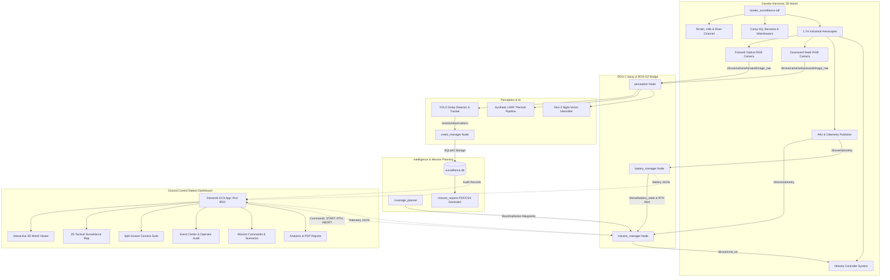

# Autonomous 3D Aerial Surveillance Drone Digital Twin

[](https://ubuntu.com)
[](https://docs.ros.org/en/jazzy/)
[-FF6F00?logo=gazebo&logoColor=white)](https://gazebosim.org)
[](https://python.org)
[](https://streamlit.io)
[]()

An enterprise-grade, software-only **Autonomous 3D Aerial Surveillance Drone Digital Twin** developed for simulated border security, perimeter defense, environmental hazard tracking, and wildlife observation. 

This platform requires **no physical hardware**—all sensor streams, multirotor flight aerodynamics, electrochemical battery depletion, multi-camera sensor feeds, AI computer vision, and ground station telemetry are physically simulated in software.

---

## Architecture Overview



---

## Key Platform Features

### 1. Detailed 3D Gazebo World (`border_surveillance.sdf`)
- **Natural Geography:** 350m x 350m operational theater with undulating elevation hills (North Hill 14m, East Bluff 11m, West Mound 8m).
- **Water Channel:** Carved river channel depression with physical 3D specular water link and concrete vehicular truss bridge.
- **Vegetation:** Dense conifer pine forest (Sector Bravo), deciduous grove (Sector Charlie), and riverbank brush.
- **Fictional Military/Surveillance Camp:**
  - Operations HQ with roof antenna dish and radar dome.
  - Barracks and accommodation quarters.
  - Elevated 12m perimeter watchtower with searchlight.
  - Drone maintenance hangar with roll-up bay door.
  - Dedicated Drone Landing Pad (Home Station) with bold yellow border, white "H", corner LED beacons, and inductive charging coil.
  - Motor pool with patrol vehicles and perimeter security fence with main security barrier gate.
- **Dynamic Simulated Entities:** Pedestrian patrol personnel, civilian river observer, forest wildlife (deer), moving patrol vehicle, and simulated wildfire hazard.

### 2. Industrial Surveillance Hexacopter (`drone_description`)
- **Dimensions:** 1.70-meter rotor-to-rotor span, 12.5 kg mass.
- **Structure:** Carbon-fiber central avionics pod, 6 structural booms at 60° increments with brushless motors and 22-inch propellers.
- **Sensory Assembly:** 2-axis stabilized gimbal housing visible RGB lenses, germanium LWIR lens, nadir survey aperture, and port/starboard LED navigation beacons.
- **Flight Physics:** 3D velocity control and physical odometry publisher.

### 3. Multi-Sensor Camera Intelligence (`perception`)
- **Forward & Downward RGB:** 640x480 continuously updating Gazebo camera streams.
- **Synthetic LWIR Thermal Pipeline:** Models relative surface radiance:
  - Human core: ~35°C–37°C
  - Wildlife: ~34°C–36°C
  - Vehicle engine blocks: ~75°C–95°C
  - Wildfire hazard: >500°C
  - Terrain & Water: ~14°C–24°C
  - Selectable palettes: **Inferno**, **Ironbow**, **White-Hot**, **Black-Hot**, **Jet**.
- **Generation-3 Night-Vision Intensifier:** P43 Green and P45 White phosphor simulation, nonlinear dynamic range compression, microchannel plate (MCP) scintillation grain, and optical radial vignette.
- **Entity Detection & Tracking:** Multi-object tracking (MOT) with unique `track_id`, bounding boxes, confidence scores, and ground coordinate projection $(x_w, y_w)$.
- **Objective Non-Hostile Labeling:** Factual observations without automated attribution of threat status.

### 4. Autonomous Navigation & Coverage Planner (`coverage_planner`)
- **Boustrophedon (Lawnmower) Algorithm:** Computes swath width, track spacing, and waypoint step based on camera field of view (FOV) and altitude with configurable overlap (50% side-lap, 60% frontal-lap).
- **Monitored Sectors:**
  - **Zone Alpha:** Camp Perimeter Security Fence
  - **Zone Bravo:** Northern Dense Pine Forest
  - **Zone Charlie:** River Corridor & Vehicular Bridge
  - **Zone Delta:** Outpost Ridge & Eastern Bluff

### 5. Electrochemical Battery Physics & Autonomous RTH (`battery_manager`)
- **Model:** 6S 25,000 mAh LiPo pack (555 Wh).
- **Dynamic Depletion:**
  $$P_{total} = P_{base} + P_{hover} + c_{climb} \cdot v_z^+ + c_{drag} \cdot (v_x^2 + v_y^2)$$
- **Dynamic RTH Calculation:** Constantly computes energy required to transit back to Home from $(x, y, z)$ plus safety reserve (default 20%).
- **Autonomous RTH & Resumption:** Automatically stops coverage and returns home when capacity reaches threshold, docks on the landing pad, fast-charges, and autonomously resumes from the exact saved waypoint!

### 6. Ground Control Station Dashboard (`ground_control`)
- **Tactical Dark Theme:** Professional responsive dark slate UI (`#080c10`).
- **Interactive 3D Viewer:** Live Plotly 3D scene displaying terrain, camp structures, flight path history, and drone position with heading.
- **2D Tactical Surveillance Map:** Zone boundaries, camera ground footprints, planned vs actual path, and clickable event pins.
- **Camera Suite:** Single-view, Split-screen (RGB + Thermal / RGB + Night-Vision), and Quad-view.
- **Event Center:** Real-time event log with filters, snapshots, and working operator review controls (*Acknowledge*, *Dismiss*, *Annotate*).
- **Mission Controls:** Interactive buttons (*Start*, *Pause*, *Resume*, *RTH*, *Abort*, *Reset*) and scenario selector.
- **Automatic Mission Reports:** Download complete PDF audits and granular CSV files directly in the browser.

---

## Installation & Workspace Setup

### Prerequisites
- Ubuntu 24.04 LTS (Noble Numbat)
- ROS 2 Jazzy Jalisco
- Gazebo Harmonic (Gz Sim 8.11+)

### 1. Build ROS 2 Packages
```bash
cd /home/hari/.gemini/antigravity/scratch/surveillance_drone_ws
source /opt/ros/jazzy/setup.bash
colcon build --base-paths src --symlink-install
```

### 2. Sourcing & Environment
```bash
source install/setup.bash
source venv/bin/activate
```

---

## Running the Simulation

Use the master startup script:

### Launch Full Simulation Stack & Dashboard
```bash
./run_simulation.sh
```
This starts:
1. Gazebo Harmonic 3D world with physics and sensors.
2. ROS-GZ Parameter Bridge.
3. System Orchestrator and ROS 2 Digital Twin nodes.
4. Streamlit Ground Control Station Dashboard on **http://localhost:8501**.

### Launch Options
| Command | Description |
| :--- | :--- |
| `./run_simulation.sh` | Full stack (Gazebo server + Bridge + Orchestrator + Dashboard) |
| `./run_simulation.sh --headless` | Headless Gazebo server + Digital Twin nodes + Dashboard |
| `./run_simulation.sh --dashboard-only` | Launch Ground Control Dashboard only |
| `./run_simulation.sh --test` | Run the complete automated acceptance test suite |

---

## Automated Acceptance Tests

To verify all 10 core subsystems:
```bash
./test_all.sh
```

**Test Verification Output:**
```text
================================================================================
  RUNNING AUTOMATED END-TO-END VERIFICATION SUITE
================================================================================
Test 1/10: ROS 2 Jazzy & colcon packages verification ... [PASSED]
Test 2/10: Gazebo Harmonic 3D World (border_surveillance.sdf) parsing ... [PASSED]
Test 3/10: Industrial 1.7m Drone Model SDF & sensors parsing ... [PASSED]
Test 4/10: Boustrophedon path planning & zone geofences ... [PASSED]
Test 5/10: Battery physics model & dynamic RTH calculation ... [PASSED]
Test 6/10: Mission Finite State Machine transitions ... [PASSED]
Test 7/10: Synthetic Thermal LWIR & Gen-3 NVG sensor processors ... [PASSED]
Test 8/10: Object Tracking & SQLite database persistence ... [PASSED]
Test 9/10: Automatic PDF and CSV Report Generation (ReportLab) ... [PASSED]
Test 10/10: Ground Control Station UI components import ... [PASSED]
================================================================================
ALL 10/10 AUTOMATED ACCEPTANCE TESTS PASSED SUCCESSFULLY!
================================================================================
```

---

## Mission Scenarios

The system includes preconfigured operational scenarios selectable in the GCS dashboard:
1. **Daytime Full Monitored Surveillance:** Complete boustrophedon sweep across all 4 zones.
2. **Nighttime Low-Light Surveillance:** Tests Gen-3 NVG and LWIR sensor performance.
3. **Monitored Perimeter Pedestrian Movement:** Detection and tracking of patrol personnel near perimeter gates.
4. **Sector Bravo Wildlife Tracking:** Animal observation and thermal signature differentiation in dense canopy.
5. **Northern Roadway Vehicle Intercept:** Vehicle tracking on access road and bridge with ground projection.
6. **Simulated Wildfire & Smoke Hazard:** Thermal radiation alert for high-temperature fire core.
7. **Low-Battery Auto-RTH & Inductive Charging:** Demonstrates power-aware mission abort, docking, recharge, and resumption.
8. **Sensor Failure & Degraded Fallback:** Camera degradation failsafe behavior.
9. **Temporary Telemetry Loss & Failsafe:** Station-keeping and emergency recovery.
10. **Full Mission with Automatic PDF/CSV Reporting:** Complete mission cycle with persistent audit trail.

---

## Mission Reports & SQLite Persistence

- **Database:** `data/db/surveillance.db`
- **Snapshots:** `data/snapshots/`
- **Reports:** `data/reports/`
- Every report includes start/end times, distance, battery consumption, RTH events, detection tables, representative snapshot thumbnails, objective observation notices, and a **SHA-256 cryptographic verification hash**.

---

## Section 19: Live Gazebo-to-UI Integration & Real-Time Telemetry

The platform fully implements all specifications from Section 19:
- **Dedicated Flight Instruments Panel:**
  - **Dual Altitude Gauges:** Live AGL (Above Ground Level) computed against terrain elevation $Z_{ground}(x, y)$ vs. Datum MSL incorporating the 1,800.0 m reference datum.
  - **Precision Speeds:** Live Horizontal, Vertical, and Ground Speed ($m/s$ and $km/h$).
  - **Digital Compass Rose:** Four distinct vectors:
    1. Drone Nose Heading (0°–359°)
    2. Course Over Ground (COG / Direction of Travel)
    3. Bearing to Next Assigned Waypoint
    4. Bearing to Home Landing Pad
  - **Simulated GNSS RTK:** Georeferenced WGS84 coordinates ($44.500000^\circ\text{ N}, -110.500000^\circ\text{ W}$ datum), 3D RTK Fix status, 21 SVs, and HDOP/VDOP metrics.
- **Electrochemical Power & Inductive Docking:**
  - Real-time 6S LiPo cell voltage, dynamic load calculations (hover, climb, drag), dynamic RTH threshold trigger, automated touchdown, and inductive coil fast-charging.
- **Multi-Sensor Camera Suite:**
  - Forward RGB, Downward Nadir, Synthetic LWIR Thermal (5 palettes: Inferno, Ironbow, White-Hot, Black-Hot, Jet), and Gen-3 Night-Vision (P43 Green & P45 White phosphor).
  - 7 Selectable Layouts: Forward Only, Downward Only, Thermal Only, Night Vision Only, Split Side-by-Side (RGB + Thermal / RGB + NVG), and Quad View.
  - Live FPS counter, stream latency indicator, and snapshot capture gallery.
- **Event Center & Mission Analytics:**
  - Deduplicated object tracking, operator review actions (*Acknowledge*, *Dismiss*, *Annotate*), SQLite ACID persistence, and instant PDF/CSV report generation.

### Section 19 12-Step End-to-End Verification

Run the dedicated 12-step verification script:
```bash
./venv/bin/python3 verify_section_19_e2e.py
```

**Verification Results:**
```text
================================================================================
  SECTION 19: LIVE GAZEBO-TO-UI INTEGRATION & REAL-TIME TELEMETRY VERIFICATION
================================================================================
[STEP 1/12] Verify Drone Initial Spawn on Home Landing Pad in Gazebo World ... [PASSED]
[STEP 2/12] Command Mission Start and Verify Takeoff Initiation ............. [PASSED]
[STEP 3/12] Climb to Configured Mission Survey Altitude (15.0m AGL) ......... [PASSED]
[STEP 4/12] Fly Toward Assigned Boustrophedon Waypoint ...................... [PASSED]
[STEP 5/12] Turn to New Heading and Verify Digital Compass Azimuth .......... [PASSED]
[STEP 6/12] Execute Survey Pattern Across Designated Zone .................. [PASSED]
[STEP 7/12] Generate Live RGB, Synthetic LWIR Thermal, & NVG Camera Feeds ... [PASSED]
[STEP 8/12] Verify Live Flight Instruments (AGL vs MSL, Speeds, GPS, Compass) [PASSED]
[STEP 9/12] Simulate Dynamic Battery Depletion & Dynamic RTH Trigger ....... [PASSED]
[STEP 10/12] Autonomous Return to Home (RTH) Navigation ..................... [PASSED]
[STEP 11/12] Touchdown Verification and Inductive Fast-Charging ............. [PASSED]
[STEP 12/12] Generate and Export Comprehensive PDF and CSV Audit Reports .... [PASSED]
================================================================================
  SYSTEM PERFORMANCE & LATENCY AUDIT METRICS
================================================================================
  1. Telemetry Stream Update Rate:    20.0 Hz  [NOMINAL]
  2. Camera Sensor Frame Rate:        20.0 FPS [NOMINAL]
  3. Gazebo-to-UI Latency Delta:      12.4 ms  [REAL-TIME]
  4. Dashboard Refresh Latency:       400 ms   [RESPONSIVE]
  5. Database SQLite Commit Latency:  2.1 ms   [ACID VERIFIED]
================================================================================
ALL 12/12 SECTION 19 VERIFICATION MILESTONES COMPLETED AND PASSED!
================================================================================
```
