# Autonomous 3D Aerial Surveillance Quadcopter Digital Twin

[](https://ubuntu.com)
[](https://docs.ros.org/en/jazzy/)
[-FF6F00?logo=gazebo&logoColor=white)](https://gazebosim.org)
[](https://python.org)
[](https://fastapi.tiangolo.com)
[]()

An enterprise-grade, software-only **Autonomous 3D Aerial Surveillance Quadcopter Digital Twin** developed for simulated border security, perimeter defense, environmental hazard tracking, wildlife observation, and multi-layer personnel identification with cryptographic ID card authentication.

This platform requires **no physical hardware**—all sensor streams, 4-rotor quadcopter flight aerodynamics, electrochemical battery depletion, multi-camera sensor feeds, AI computer vision, personnel RF emissions, and ground station telemetry are physically simulated in software.

---

## Architecture Overview

```mermaid
graph TD
    subgraph Gazebo Harmonic 3D World
        W[border_surveillance.sdf] --> T[Terrain, Hills & River Channel]
        W --> C[Camp HQ, Barracks & Watchtowers]
        W --> BORDER[Border Demarcation Y = 32m]
        W --> D[1.7m Industrial Quadcopter X-Frame]
        D --> CAM1[Forward Optical RGB Gimbal]
        D --> CAM2[Downward Nadir RGB Camera]
        D --> IMU[IMU & Odometry Publisher]
        D --> MOT[4x Counter-Rotating Propellers PID JointController]
        W --> PERS[Simulated Personnel with Wearable Electronic Tags]
    end

    subgraph ROS 2 Jazzy & ROS-GZ Bridge
        CAM1 -->|/drone/camera/forward/image_raw| PERC[perception Node]
        CAM2 -->|/drone/camera/downward/image_raw| PERC
        IMU -->|/drone/odometry| MM[mission_manager Node]
        IMU -->|/drone/odometry| BM[battery_manager Node]
        MM -->|/drone/cmd_vel| MOT
    end

    subgraph Perception & AI
        PERC --> DET[YOLO Entity Detector & Tracker]
        PERC --> THERM[Synthetic LWIR Thermal Pipeline]
        PERC --> NVG[Gen-3 Night-Vision Intensifier]
        DET -->|/events/observations| EM[event_manager Node]
    end

    subgraph Multi-Layer Personnel Security Stack
        TAGS[personnel_tag_node] -->|UWB / RFID / BLE Packets| CRYPT[credential_authentication_node]
        CRYPT -->|HMAC-SHA256 & Anti-Replay| CORR[identity_correlation_node]
        PERC -->|Facial ROIs & IQA| FACE[face_verification_node]
        FACE -->|Consented Synthetic Match| CORR
        CORR -->|Identity State Machine 6 States| AUDIT[personnel_event_logger]
        SECPOL[activity_assessment_node] -->|Restricted Infrastructure Geofence| CORR
        AUDIT -->|SQLite Persistence| DB[(surveillance.db)]
    end

    subgraph Intelligence & Mission Planning
        CP[coverage_planner] -->|Boustrophedon Waypoints Country A| MM
        BM -->|/drone/battery_state & Dynamic RTH| MM
        DB --> REP[mission_reports PDF/CSV Generator]
    end

    subgraph Modern Tactical Ground Control Station
        GCS[FastAPI + WebSockets Backend: Port 8080]
        GCS --> PFD[Primary Flight Display ADI & 4-Needle Compass]
        GCS --> TMAP[Tactical Surveillance Map & Coverage Grid]
        GCS --> CAMSUITE[Live MJPEG Multi-Camera Streams]
        GCS --> PERS_PANEL[Personnel ID & Authentication Cockpit]
        GCS --> NOID_ALERT[NO ID CARD Security Warning Banner]
        GCS --> VOICE[Simulated Voice Safety Advisory]
    end

    MM -.->|Telemetry JSON| GCS
    BM -.->|Battery JSON| GCS
    CORR -.->|Personnel JSON| GCS
    GCS -.->|Operator Commands & Scenario Injection| MM
```



---

## Key Platform Features

### 1. Industrial Quadcopter X-Frame (`drone_description`)
- **Configuration:** 4-rotor industrial X-frame with 1.70-meter motor-to-motor span and 12.5 kg total takeoff weight.
- **Propulsion Dynamics:** 4 counter-rotating 22-inch propellers spinning at $\pm 85\,\text{rad/s}$ ($810\,\text{RPM}$) powered by Gazebo Harmonic PID `JointController` velocity controllers.
- **Sovereign Airspace Boundary:** Hard geofence $Y \le 28.5\,\text{m}$ strictly confining flight to Country A (Home Sovereign Territory), never crossing the international border at $Y = 32.0\,\text{m}$.

### 2. Multi-Layer Personnel Identification & Authentication (`personnel_security`)
- **Layer 1: Electronic Personnel Tags & Cryptography:**
  - Wearable devices: Encrypted RFID/NFC smartcards, UWB tactical beacons, and BLE-5.3 identification tags.
  - Cryptographic challenge-response via **HMAC-SHA256**.
  - **Anti-Replay Protection:** Sliding timestamp window with nonce cache rejecting replayed credentials.
  - **Duplicate / Cloned Token Detection:** Kinematic plausibility analysis flags duplicate hardware UUIDs presented across physically impossible distances.
- **Layer 2: Visual Identity Verification:**
  - Image Quality Assessment (IQA): Laplacian variance sharpness and mean luminance checks.
  - Degraded conditions (fog, night, obscuration) safely default to `UNVERIFIED` without inventing false identities.
  - Biometric template matching against a consented synthetic database using cosine similarity (biometric embeddings are withheld from public APIs for data minimization).
- **Multi-Source Identity Correlation (6 States):**
  1. `AUTHENTICATED` (Valid electronic credential verified)
  2. `VISUAL_VERIFIED` (Face matched in consented test database)
  3. `UNVERIFIED` (Insufficient identity information; non-hostile)
  4. `UNKNOWN_TAG` (Unregistered electronic credential)
  5. `CREDENTIAL_CONFLICT` (Duplicate or cloned token detected)
  6. `IDENTITY_REVIEW_REQUIRED` (Human operator review required)
- **Individual with NO ID CARD Detection & Security Alert:**
  - When an individual is detected optically with zero electronic credentials (`has_id_card: false`, `tag_type: NO_ID_CARD_DETECTED`), the system flags a prominent `NO_ID_CARD_ALERT`.
  - Dispatches neutral simulated voice safety advisory: *“Identity verification required. Please remain in the designated safe area and contact authorized personnel.”*
  - Policy strictly enforces **non-coercive rules** (`hostile_classification: false`).
- **AI-Assisted Suspicious Activity Assessment:**
  - Restricted infrastructure geofencing (Ammunition Depot, HQ Bunker, Maintenance Hangar).
  - Strictly distinguishes object detections from identity failures and policy-defined security events.

### 3. Tactical Ground Control Station (GCS) on Port 8080
- **Primary Flight Display (PFD):** Attitude Director Indicator (ADI) artificial horizon, 4-needle compass rose (Heading, COG, Waypoint, Home), dual altitudes (AGL vs MSL Datum), and 6S LiPo power telemetry.
- **Dedicated Personnel Identification & Verification Panel:**
  - Status indicators: Green (Authenticated), Blue (Visual Verified), Yellow (Unverified), Orange (Credential Conflict), Red (Security Policy Event).
  - Real-time identity details, tag type, military unit, face status, and review controls.
  - Scenario switcher supporting Scenarios A, B, C, D, and E (Subject with No ID Card).
- **Multi-Camera MJPEG Streaming:** Overview observer, forward optical RGB, synthetic LWIR thermal, Gen-3 NVG intensifier, and downward survey nadir cameras.
- **Tactical Map:** 100% offline Leaflet vector map with real-time $5\,\text{m} \times 5\,\text{m}$ coverage grid and radar pulse target discovery pins.

---

## Quick Start & Verification

### 1. Environment Setup
```bash
cd /home/hari/.gemini/antigravity/scratch/surveillance_drone_ws
source /opt/ros/jazzy/setup.bash
source install/setup.bash
source venv/bin/activate
```

### 2. Run Verification Test Suites
```bash
# 1. Multi-Layer Personnel Security (All 9 tests including NO ID CARD alert)
./venv/bin/python3 verify_personnel_security.py

# 2. Border Line & Computer Vision Detections (All 6 tests)
./venv/bin/python3 verify_border_and_detections.py

# 3. Complete End-to-End Test Suite (All 11 acceptance tests)
bash test_all.sh

# 4. GCS UI Commands & Telemetry Instrumentation (All 10 tests)
./venv/bin/python3 test_all_ui_commands_and_status.py
```

### 3. Launch Complete Simulation & GCS
```bash
# Start full system simulation and GCS dashboard
bash run_simulation.sh
# Open Ground Control Station in your browser:
# http://localhost:8080
```
